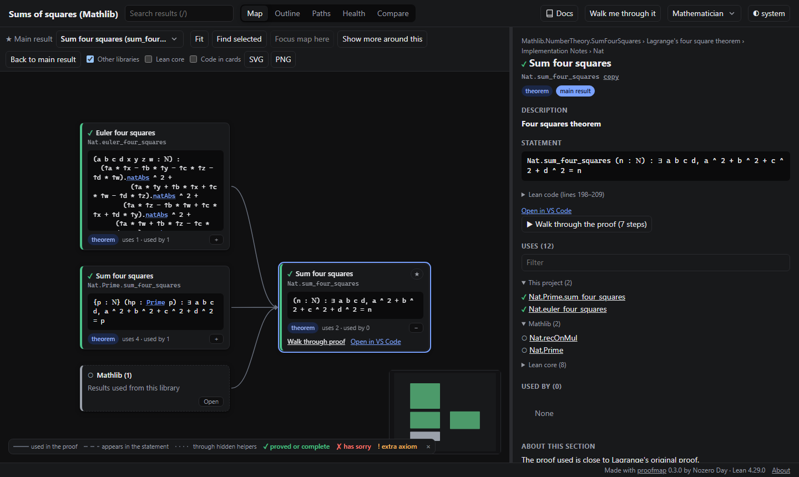

# proofmap

[](https://github.com/n0zer0d4y/proofmap/actions/workflows/ci.yml)
[](https://lean-lang.org)
[](docs/faq.md#can-i-map-part-of-mathlib-or-of-another-dependency)
[](LICENSE)

An interactive map of a Lean 4 project, for the people who read it, not only the people who wrote it.

proofmap reads a Lean project's compiled code and writes one HTML page that shows how the results depend on each other. Readers can start at the main theorem and follow it down to the definitions, see each statement in plain words, step through tactic proofs goal by goal, and check that nothing rests on `sorry` or an extra axiom. The page works offline: double-click it, email it, or put it on GitHub Pages.



- **Map:** the main results with what they rest on, laid out left to right. Generated helpers and library internals are folded away until you ask for them.
- **Outline:** the proof as a table of contents, with each result's summary taken from its docstring or comments.
- **Walkthrough** (optional, `--walkthrough`): the goals before and after every tactic step, with the changes highlighted.
- **Path finder:** "how does this definition reach that theorem?", answered in plain words.
- **Health:** how many theorems, definitions and main results there are, where the sorry is, extra axioms, and what depends on them.
- **Compare:** what was added, removed or changed since an earlier version.

Everything runs on your machine. proofmap sends nothing anywhere, and the page loads nothing from the network.

## Table of Contents

- [Security](#security)
- [Background](#background)
- [Install](#install)
- [Usage](#usage)
- [Documentation](#documentation)
- [Contributing](#contributing)
- [License](#license)

## Security

- **proofmap runs your project's code, as `lake build` does.** It imports the compiled modules, which runs their initializers. With `--walkthrough`, it also elaborates the source files again. Run it only on code you would also build.
- **Nothing leaves your machine.** proofmap makes no network requests. The page loads no fonts, scripts or analytics. `proofmap serve` listens on 127.0.0.1 only, and answers only requests addressed to it.
- **The page contains your code.** It includes your declarations' source, statements and comments, so share it only as you would share the code. When the project is a git checkout, it also includes the repository's address (from `origin`, without credentials) for source links; `repoUrl = ""` in `proofmap.toml` leaves it out. It contains no absolute path of your computer: file paths are relative to the project.

To report a security problem, use "Report a vulnerability" on the repository's Security tab rather than a public issue.

## Background

A Lean project records exactly which declarations each result uses, but that information is hard to see from the source. Existing tools each cover part of it:

- [doc-gen4](https://github.com/leanprover/doc-gen4) documents declarations.
- [Lean blueprints](https://github.com/PatrickMassot/leanblueprint) draw a dependency graph from a hand-written LaTeX plan.
- Graph tools such as [LeanDepViz](https://github.com/cameronfreer/LeanDepViz) and [lean-graph](https://github.com/patrik-cihal/lean-graph) draw the raw dependency graph.

proofmap aims at a reader who wants to understand a finished, or nearly finished, proof:

- **It starts from the code.** Every edge comes from what Lean recorded, split into "used in the statement" and "used in the proof". Nothing is written by hand.
- **Status follows the whole chain.** A result is flagged when anything below it, at any depth, uses `sorry` or an axiom outside the standard three, and **Why?** names the chain.
- **Big projects stay readable.** The map opens from the main theorem one step at a time. Each library collapses into one card, and generated helpers are hidden. It has been tested on a 13,759-declaration project that depends on Mathlib.
- **The page is self-contained.** It is a single offline file, or a folder for a static web host.

How it works: proofmap loads the project's `.olean` files in parallel worker processes, and reads each declaration's statement, dependencies and axioms. It then reads the source files for docstrings, comments and sections, and writes the page. Results are cached in `.lake/proofmap/`, so a build where nothing changed takes seconds.

Walkthroughs are optional (`--walkthrough`). Lean does not keep the goals of each tactic step in its compiled files, so recording them means elaborating every proof again, which takes about as long as `lake build`.

## Install

proofmap needs [elan](https://github.com/leanprover/elan) (every Lean user already has it), git, and a project on Lean **v4.28.0 or newer**. Pick one of two ways to install it.

### Global install (no change to your project)

Windows (PowerShell):

```powershell
irm https://raw.githubusercontent.com/n0zer0d4y/proofmap/main/install.ps1 | iex
```

macOS and Linux:

```sh
curl -fsSL https://raw.githubusercontent.com/n0zer0d4y/proofmap/main/install.sh | sh
```

Open a new terminal, then, in any Lean project:

```sh
lake build            # proofmap reads the compiled project
proofmap build        # writes proofmap.html
proofmap open         # opens it in your browser
```

The first `proofmap build` for each Lean version compiles a matching proofmap engine. This is needed because Lean's compiled files can only be read by a program built with the same Lean version. It takes a few minutes and happens once per Lean version. `proofmap doctor` shows what proofmap found, and how to fix anything it couldn't.

### Project install (pinned for everyone working on the project)

Add proofmap to the lakefile. In `lakefile.toml`:

```toml
[[require]]
name = "proofmap"
git = "https://github.com/n0zer0d4y/proofmap"
rev = "v0.3.0"
subDir = "lean"
```

Or in `lakefile.lean`:

```lean
require proofmap from git "https://github.com/n0zer0d4y/proofmap" @ "v0.3.0" / "lean"
```

Then:

```sh
lake update proofmap
lake exe proofmap build
lake exe proofmap open
```

With the project install you can also tag declarations in the code with `@[proofmap ...]` (see [configuration](docs/config.md#the-proofmap-attribute)).

## Usage

| Command                                                  | What it does                                                                                                                                                                                                                                     |
| -------------------------------------------------------- | ------------------------------------------------------------------------------------------------------------------------------------------------------------------------------------------------------------------------------------------------ |
| `proofmap build`                                         | Runs `lake build`, extracts the project and writes `proofmap.html`. `--site DIR` writes a folder for static hosting instead; `--json FILE` also writes the data; `--walkthrough` adds tactic walkthroughs (slow: about as long as `lake build`). |
| `proofmap open [FILE]`                                   | Opens the page in your default browser.                                                                                                                                                                                                          |
| `proofmap serve [--open]`                                | Builds, then serves the page on `127.0.0.1` only. Run `proofmap build` again in another terminal and the open page reloads by itself.                                                                                                            |
| `proofmap check [--strict]`                              | Validates `proofmap.toml` and lists what depends on `sorry` or on extra axioms. With `--strict` it exits with code 3 if anything is flagged, for use in CI.                                                                                      |
| `proofmap compare OLD.json NEW.json`                     | Lists what changed between two snapshots (from `build --json`) and writes a page that shows it.                                                                                                                                                  |
| `proofmap doctor`, `engines`, `self-update`, `uninstall` | Global install only: diagnose the setup, list or prune cached engines, update, remove.                                                                                                                                                           |

`proofmap --help` lists every option. Exit codes: 0 OK, 1 usage or configuration error, 2 build failure, 3 `check --strict` found problems.

By default proofmap maps the libraries your lakefile declares (each `lean_lib`, with all of its built modules). To choose other modules, or to add titles, summaries and other settings, add a `proofmap.toml` next to the lakefile:

```toml
[project]
title = "Sums of squares"
rootModules = ["Mathlib.NumberTheory.SumFourSquares", "Mathlib.NumberTheory.SumTwoSquares"]
roots = ["Nat.sum_four_squares"]     # the main results the page starts from
```

Without a `proofmap.toml`, proofmap picks the page title (from `CITATION.cff`, the README's first heading or the package name) and the main results itself, and says what it chose. To publish the page with GitHub Pages and link to it from your README with a badge, see [the FAQ](docs/faq.md#how-do-i-publish-the-page-on-github-pages).

How long a build takes, measured on a 130-module project that depends on Mathlib (13,759 declarations; 4 cores, 16 GB):

| Build                                     | Time                                                                      |
| ----------------------------------------- | ------------------------------------------------------------------------- |
| `proofmap build`, first run               | about 2.5 minutes, mostly loading Mathlib                                 |
| `proofmap build`, nothing changed         | about 10 seconds                                                          |
| `proofmap build --walkthrough`, first run | 55 minutes with `--jobs 3` (`lake build` of the same project: 45 minutes) |

## Documentation

- [User guide](docs/guide.md): reading a proofmap page, for readers, mathematicians, developers and auditors.
- [Configuration](docs/config.md): `proofmap.toml` and the `@[proofmap ...]` attribute.
- [Data format](docs/schema.md): `proofmap.json`, for tools that read it, with its [JSON Schema](schema/proofmap.schema.json).
- [FAQ](docs/faq.md): toolchains, private code, big projects, CI.
- [Changelog](CHANGELOG.md).

## Contributing

Issues and pull requests are welcome. The repository has three parts:

| Folder    | What it is                                                                                                                                             |
| --------- | ------------------------------------------------------------------------------------------------------------------------------------------------------ |
| `lean/`   | The Lake package: extractor, commands, HTTP server and launcher (Lean 4). `lean/assets/viewer.html` is the viewer template embedded in the executable. |
| `viewer/` | The page (React, TypeScript, Vite). `npm run build` writes `viewer/dist/index.html` and copies it to `lean/assets/viewer.html`.                        |
| `schema/` | The JSON Schema of `proofmap.json`. The viewer's types are generated from it (`npm run gen:types`).                                                    |

Building from source needs elan and Node.js 22. Build the viewer first, because the executable embeds it:

```sh
cd viewer && npm ci && npm run build
cd ../lean && lake build && lake test
```

Tests:

| Command                                                      | What it checks                                                                                                                                                                                                                                          |
| ------------------------------------------------------------ | ------------------------------------------------------------------------------------------------------------------------------------------------------------------------------------------------------------------------------------------------------- |
| `cd lean && lake test`                                       | Lean unit tests                                                                                                                                                                                                                                         |
| `bash .github/scripts/ci-lean.sh leanprover/lean4:v4.29.0`   | Builds the package and the fixture project on one toolchain, checks the extracted data against the schema and the expected manifest, and checks `serve`, `check` and `compare`. Set `PROOFMAP_E2E=1` to add the browser tests that need the executable. |
| `cd viewer && npm run lint && npm run typecheck && npm test` | Viewer lint, types and unit tests                                                                                                                                                                                                                       |
| `cd viewer && npm run e2e`                                   | Browser tests on the fixture pages, including accessibility (axe-core). `ALL_BROWSERS=1` adds Firefox and WebKit.                                                                                                                                       |

CI runs on every push, except pushes that change only documentation. It runs the Lean checks on Lean v4.28.0 and v4.35.0, the oldest and newest supported versions, and the viewer checks on Chromium, Firefox and WebKit. It also checks that the committed `lean/assets/viewer.html` matches a fresh viewer build. Please add a test with each change, and a line in the [changelog](CHANGELOG.md).

## License

proofmap is licensed under the [Apache License 2.0](LICENSE). If you redistribute it, keep the [NOTICE](NOTICE) file. Generated pages carry a small "Made with proofmap" footer, which `[display] footer = false` hides. If proofmap helps your research, GitHub's "Cite this repository" button gives a citation (from [CITATION.cff](CITATION.cff)).

Copyright 2026 Nozero Day.
