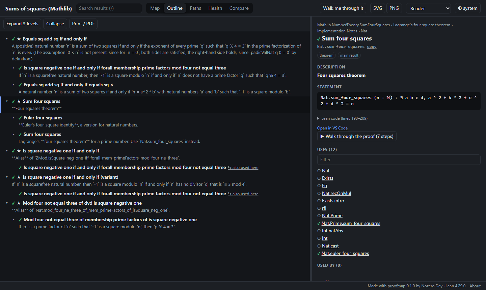
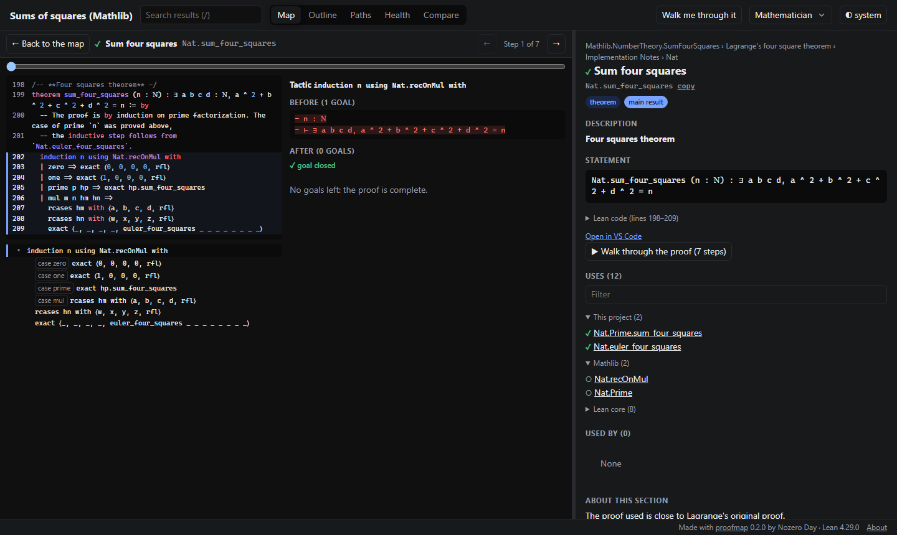
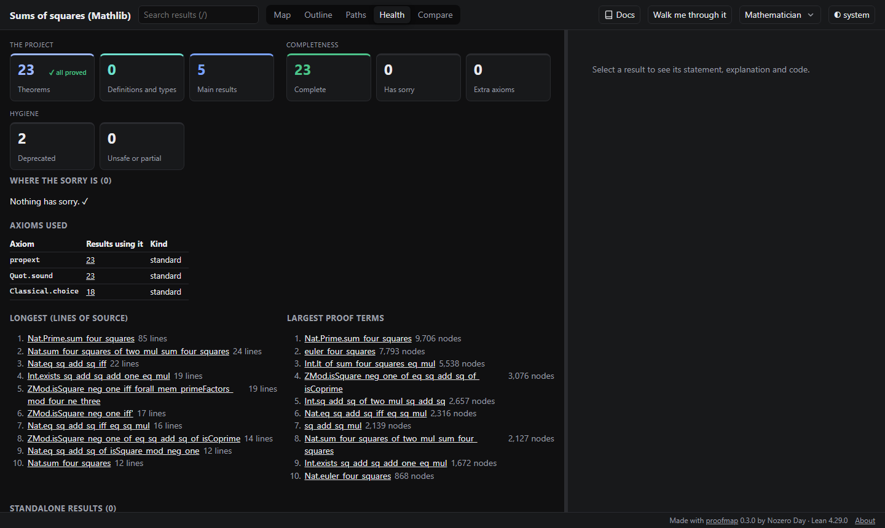

# User guide

A proofmap page is one HTML file (or one folder, for a site). It needs no server and no network: open it in any current browser. Where you are on the page is kept in its address (the view, the selection, what is open on the map and the preset), so the back button works and a copied link opens the same place for whoever you send it to. The theme is remembered by your browser and is not part of links.

## The page at a glance

- **Header:** the project title, the search box (press `/` to jump to it; it searches names, titles and summaries), the views (Map, Outline, Paths, Health, Compare), **Docs** (this guide, also opened with `?`; on narrower windows only its book icon shows), **Walk me through it**, the persona preset and the theme switch (system, light, dark).
- **Main area:** the current view.
- **Details panel** (right, resizable): everything about the selected declaration.
- **Footer:** _About_ shows the proofmap and Lean versions, when the page was built and its data format, with _Copy details_ for a bug report, and the license. It closes from its top right corner (or with Escape).

Every status is shown by colour **and** by an icon and words, so it reads without colour too:

| Mark                                               | Words                                             | Meaning                                                                                                                                                    |
| -------------------------------------------------- | ------------------------------------------------- | ---------------------------------------------------------------------------------------------------------------------------------------------------------- |
| ✓ green      | **Proved** (theorems), **Complete** (other kinds) | No `sorry` and only the standard axioms, in it and in everything it rests on. Counts say "Complete" and the legend "proved or complete", since a proved theorem is complete too. |
| ✗ red     | **Has sorry**                                     | A `sorry` in it or somewhere below it; the details panel names where ("Rests on sorry in X").                                                              |
| ! amber   | **Extra axiom**                                   | It rests on an axiom beyond the standard three; the details panel names it, or says "Trusts compiled code" for `native_decide`.                            |
| ○ grey | **Other library**                                 | From another library (Mathlib, core); not checked by this page.                                                                                            |

Each kind of declaration has its own colour, the same on map cards, in the details panel and in Health's lists: theorem lemma definition abbreviation structure inductive type constructor instance axiom. A main result is one of the headline results the page starts from, as the project names them (in the `## Main statements` sections of its files, or in `proofmap.toml`), else as proofmap guesses them; private, deprecated and simp (a lemma the simp tactic rewrites with) are notes, and unsafe or partial marks code that skips some of Lean's checks. Two declarations in different modules can have the same name; wherever names are shown, such a name has its module next to it (on map cards, its last part).

## Views

### Map

The map starts at a main result and shows what it rests on, laid out left to right with the result on the right; arrows point from what is used to what uses it. It shows a readable amount at a time: helpers that Lean generates (instances, auxiliary lemmas, matchers) are hidden, and declarations from other libraries are gathered into one card per library (Mathlib, Lean core). Lean core is hidden for readers and mathematicians.

- **Cards** show a declaration's status, title, Lean name, its kind (as a coloured badge), its statement (or its one-line summary; a long statement scrolls inside the card), and how many results of the project it uses and how many use it. Click a card to select it; the details panel then shows it in full. **+** (or Enter) shows what the card rests on and **−** (or Escape) hides it again. The main result starts open, so its button is **−**: closing it leaves only the main result on the map.
- **Edges** read as sentences (hover one): a solid line means "is used in the proof of", a dashed line "appears in the statement of", a dotted line "is used through hidden helpers". A highlighted chain (a tour step, or **Show on map** for a "Why?" chain) is drawn in the highlight colour with moving dashes, or still lines for readers who ask for less motion.
- **Group cards** ("+12 in The prime case") and library cards open in place.
- **Toolbar:** _Main result_, the result the map is built around (a list when the project has several), _Fit_, _Find selected_, _Focus map here_ (rebuild the map around the selection), _Show more around this_ (one more ring of what the selection rests on, each click), _Back to main result_, the _Other libraries_, _Lean core_, _Generated helpers_ and _Code in cards_ switches, and _SVG_ / _PNG_.
- **Keyboard:** with the map focused, arrow keys move between cards, Enter shows what a card rests on, Escape hides it, `f` builds the map around the selection, `p` picks it for the path finder. On a toolbar button or switch, keys act on that control.
- **Following a link:** selecting something that is not on the map (from search, a link, the health view or a statement) rebuilds the map around it.
- The view keeps cards readable: it opens at a zoom where text can be read, and pans to cards as they appear. The legend can be folded away.

### Outline

The proof as a table of contents: each main result, then what it rests on (theorems before definitions), indented, each with its summary. A declaration used in several places appears in full the first time and as "also used here" afterwards. _Expand all_ and _Collapse all_ open and close every row (on very large projects, Expand all stops before 2,000 rows). Selecting something opens the outline down to it. What is open and where you scrolled stay as they were when you come back from another view. _Print / PDF_ prints the outline as it is open, with each declaration's statement, across as many pages as it needs at full page width; the controls and the details panel are left out.

### Details panel

For the selected declaration: where it lives (module and section), its title and Lean name (with a copy button), coloured badges explaining its kind (each kind has its own colour, the same on map cards and in Health's lists), and "main result" or "lemma" where that applies, how many of the main results rest on it ("Needed for 2 of 5 main results", with a small meter; hover it for their names), the `#print axioms`, `#check` or `#eval` commands in the project's own files that name it ("Named by #print axioms at File.lean:930"), its summary and docstring (Markdown, with maths), the comment above it in the source, its statement with linked names (hover a name for its statement, click to go there), the source with the file's line numbers, links to open the line in VS Code or on GitHub (when the page knows the project's repository; never for a dependency's files, which are not in it), and the lists of what it uses and what uses it.

When a result depends on `sorry` or an extra axiom, the panel says where it comes from ("Rests on sorry in X", "Uses the axiom X", or "Trusts compiled code" for `native_decide`); **Why?** lists the chain down to it, and **Show on map** highlights that chain.

### Walkthrough

For a proof written with tactics, **▶ Walk through the proof** shows the source with the current step highlighted, next to the goals before and after that step. Changed lines are highlighted; a finished goal shows "✓ goal closed", and when a case is finished but others remain, the view says so ("This case is done") rather than that the proof is complete.

Walkthroughs are in the page only when it was built with `proofmap build --walkthrough` (or `[walkthrough] enabled = true`). Recording them means elaborating every proof again, which takes about as long as `lake build`, so they are off by default.

- ← and → step back and forward; the slider jumps anywhere; the step list jumps to a step. The step list shows the case each step works on (`case zero`) where it changes, and a bullet `· t` with a single tactic is one step.
- A compound step (such as `constructor` followed by its cases) can be collapsed to one step.
- The tabs and _Back to the …_ leave the walkthrough; Back in the browser returns to where it was opened.
- A proof written as a single term has no steps; the view says so and shows the code.

### Path finder

Pick a **from** and a **to** (search boxes, or `p` on the map). Click a box to see its choices without typing. Once one end is chosen, the other box offers only the declarations that connect to it, the project's own first. The page shows the chains between them up to a length limit, shortest first, as a small map, and the shortest one as a numbered list in plain words: "`Int.lt_of_sum_four_squares_eq_mul` is used in the proof of `Int.exists_sq_add_sq_add_one_eq_mul`, which is used in the proof of ...".

### Health

Counts in three groups (click a count to list them): **the project** (theorems, with "all proved" or how many are not, definitions and types, and main results), **completeness** (complete, has sorry, extra axioms) and **hygiene** (deprecated, unsafe or partial). Below them, the definitions and types are counted by kind (definitions, abbreviations, structures, inductive types and their constructors), adding up to the tile's number. Then where the sorry is, each with how many results rest on it; which axioms are used and by which results; the longest proofs; **standalone results** (documented theorems that nothing else uses, usually findings in their own right); declarations that may be unused (a refactoring aid: next to each is any `#print axioms`, `#check` or `#eval` in the project's own files that names it, and whether it is private, usually a leftover helper, or a simp lemma, usually kept on purpose; scripts and documents outside Lean are not read, so a result checked only there appears too); and progress per module and per step, with steps grouped by file in source order. Declarations that Lean generated without a source location, such as match splitters and congruence lemmas, are left out of these lists, and the page says how many there are.

### Compare

Shows what changed since an older version: results added, removed and changed (statement, code, status or dependencies), and status changes such as "no longer has sorry: 12". Selecting a changed result shows, in the details panel, what it was in the older version. Open it on a page made by `proofmap compare OLD.json NEW.json`, or choose an older `proofmap.json` (from `proofmap build --json`) right in the view. While a comparison is loaded, new and changed results carry a badge on the map.

### Walk me through it

A guided tour: it starts at the main result and walks down the outline on the map, one card at a time, narrated by the summaries. Its panel sits in the map's lower left corner, above the legend, and shows only on the map; another view hides it, and it is back at the same step when you return. _Next_ and _Back_ move through it; **✕** at its top right (or Escape) ends it.

## Presets: where to start

The preset (header) sets what the page shows and which view it opens with; switching later keeps you where you are.

**Reader** (you want the story of the proof). Start in the outline. Read the main result's summary, then the summaries of the steps beneath it. Expand only what you want to read in full; Lean names stay in the background. _Walk me through it_ reads the outline to you, one result at a time.

**Mathematician** (you want the statements). Start on the map, where statements are expanded. Hover names in a statement to see what they mean. Open a tactic proof's walkthrough to see the goals change. Use the path finder to see how a definition feeds a theorem.

**Developer** (you work on the code). Code is shown and the switches for generated helpers are visible. _Open in VS Code_ jumps to the line. The health view lists declarations that no other declaration uses, and the largest proofs. Run `proofmap serve` while you work: each `proofmap build` reloads the open page.

**Auditor** (you check what is actually proved). Start in the health view: it should say 0 `sorry` and list only the standard axioms. For anything flagged, _Why?_ names the declaration responsible. In CI, `proofmap check --strict` fails the build when anything depends on `sorry` or an extra axiom.

## Keyboard shortcuts

| Key                                                 | Where       | What it does                           |
| --------------------------------------------------- | ----------- | -------------------------------------- |
| <kbd>/</kbd>                                        | anywhere    | jump to search                         |
| <kbd>?</kbd>                                        | anywhere    | open these docs                        |
| <kbd>←</kbd> <kbd>↑</kbd> <kbd>→</kbd> <kbd>↓</kbd> | map         | move between cards                     |
| <kbd>Enter</kbd> / <kbd>Esc</kbd>                   | map         | show or hide what the card rests on    |
| <kbd>f</kbd>                                        | map         | build the map around the selection     |
| <kbd>p</kbd>                                        | map         | pick the selection for the path finder |
| <kbd>←</kbd> <kbd>→</kbd>                           | walkthrough | previous or next step                  |
| <kbd>Esc</kbd>                                      | guided tour | end the tour                           |

## Sharing

- **One file:** send `proofmap.html`. It opens by double-click, offline.
- **A website:** `proofmap build --site public/` writes `index.html` and a `data/` folder that work under any sub-path, for example on GitHub Pages. Walkthroughs then load only when opened.
- **A link to a view:** copy the address; it carries the view, the selection, what is open and the preset.
- **A picture:** _SVG_ or _PNG_ in the map toolbar saves the whole map, not only the part on screen. The SVG is made of shapes and text, so it can go into a paper or a vector editor. The outline prints to PDF.
- **No local paths:** a page records no folder of your computer. When it is inside the project (as `proofmap.html` is by default), it records only how many folders up the project is, so _Open in VS Code_ works when the page is opened from the project on your computer. A page written outside the project has no _Open in VS Code_ links, since where the project is would reveal your folders; `proofmap build` says so.
